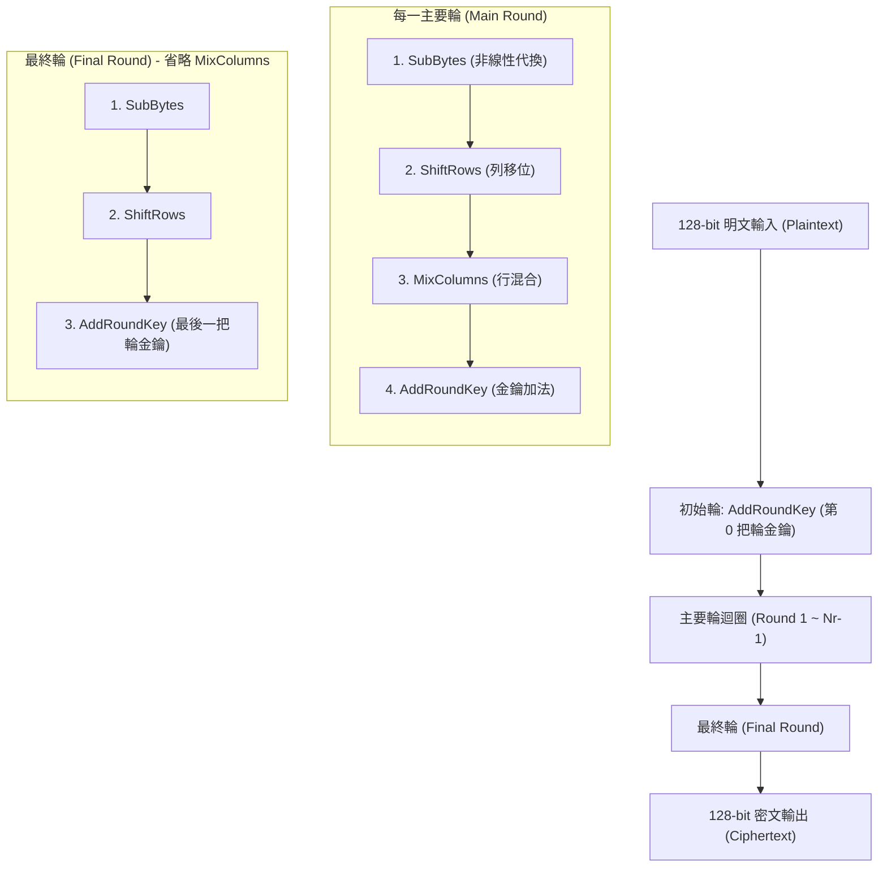

# AES（進階加密標準）完整解析指南

> 本文介紹密碼學中最廣泛應用的對稱金鑰區塊加密演算法 —— **AES（Advanced Encryption Standard）**，涵蓋其運作原理、演算法結構、工作模式（Modes of Operation）、現實生活應用情境，以及硬體加速（AES-NI）的核心意義。

---

## 目錄
1. [什麼是 AES？](#一什麼是-aes)
2. [AES 的核心設計與數學架構](#二aes-的核心設計與數學架構)
3. [單輪加密到底做了什麼？](#三單輪加密到底做了什麼)
4. [為什麼單有 AES 還不夠？區塊工作模式](#四為什麼單有-aes-還不夠區塊工作模式)
5. [現實世界中什麼情境會用到 AES？](#五現實世界中什麼情境會用到-aes)
6. [硬體加速指令（AES-NI）的關鍵價值](#六硬體加速指令aes-ni的關鍵價值)
7. [與本專案的關聯](#七與本專案的關聯)

---

## 一、什麼是 AES？

**AES（Advanced Encryption Standard，進階加密標準）** 是當今全世界使用最普遍的**對稱金鑰區塊加密演算法（Symmetric Block Cipher）**。

### 1. 歷史背景
* **起源**：1997 年，美國國家標準暨技術研究院（NIST）發起競賽，尋找能取代老舊且金鑰長度過短（56-bit）、易被暴力破解的 DES（Data Encryption Standard）。
* **勝出者**：由比利時密碼學家 Joan Daemen 與 Vincent Rijmen 所設計的 **Rijndael** 演算法在 2000 年獲選。
* **標準化**：2001 年由 NIST 正式發布為 **FIPS PUB 197** 標準，正式定名為 AES。

### 2. 基本特徵
* **對稱金鑰（Symmetric-key）**：加密與解密使用相同的密鑰（或由同一把金鑰推導出）。
* **固定區塊大小（Block Size）**：**永遠是 128 位元（16 位元組）**。無論明文有多長，AES 每次只處理一個 16-byte 的區塊。
* **支援三種金鑰長度**：
  * **AES-128**：金鑰 128 位元（16 bytes），執行 **10 輪**。
  * **AES-192**：金鑰 192 位元（24 bytes），執行 **12 輪**。
  * **AES-256**：金鑰 256 位元（32 bytes），執行 **14 輪**。

> [!NOTE]
> 目前世界上最強大的超級電腦，即使耗費宇宙年齡的時間，也無法以暴力窮舉（Brute-force）破解 AES-128 或 AES-256。

---

## 二、AES 的核心設計與數學架構

AES 不是傳統 DES 的 Feistel 網路架構，而是採用 **SPN 網路（Substitution-Permutation Network，代換-排列網路）**。

### 1. 狀態矩陣（State Matrix）
AES 將 16 位元組（128 bits）的輸入資料視為一個 $4 \times 4$ 的二維矩陣（以行優先 Column-major 排列）：

$$
\begin{bmatrix}
s_0 & s_4 & s_8 & s_{12} \\
s_1 & s_5 & s_9 & s_{13} \\
s_2 & s_6 & s_{10} & s_{14} \\
s_3 & s_7 & s_{11} & s_{15}
\end{bmatrix}
$$

### 2. 整體加密流程

AES 加密流程可分為三個階段：

---

## 三、單輪加密到底做了什麼？

AES 的設計完全遵循密碼學家香農（Claude Shannon）提出的兩大安全性核心原則：**混淆（Confusion）**與**擴散（Diffusion）**。

| 步驟 | 運算類型 | 密碼學目的 | 底層運算本質 |
| :--- | :--- | :--- | :--- |
| **1. SubBytes** | 非線性位元組代換 | **混淆（Confusion）** | 查 S-Box 表；數學上為 $\text{GF}(2^8)$ 乘法求逆 + 仿射變換 |
| **2. ShiftRows** | 行向循環位移 | **擴散（Diffusion）** | 純位置重排（Row 0~3 分別位移 0, 1, 2, 3 格） |
| **3. MixColumns** | 欄向矩陣乘法 | **擴散（Diffusion）** | $\text{GF}(2^8)$ 上的多項式乘法（以 `xtime` 與 XOR 實現） |
| **4. AddRoundKey**| 金鑰混合 | **金鑰注入** | 狀態矩陣與輪金鑰做純位元 `XOR` |

### 為什麼最終輪不需要 `MixColumns`？
AES 的解密需要倒過來進行。如果最後一輪包含 `MixColumns`，解密方就必須在最開頭多做一次昂貴的逆向混合（`InvMixColumns`）。省略最後一輪的 `MixColumns` 使得加密與解密在結構上完全對稱，降低了硬體電路的複雜度與晶片面積。

---

## 四、為什麼單有 AES 還不夠？區塊工作模式

AES 本身**一次只能加密 16 個位元組**。若要加密數百 MB 的檔案或網路封包，必須使用**工作模式（Mode of Operation）**。

選錯模式會徹底摧毀安全性！

### 1. ECB（Electronic Codebook，電子密碼本模式）❌ **絕對不要使用**
* **原理**：將資料切成每 16 bytes 一塊，各塊各自獨立用相同的金鑰進行 AES 加密。
* **缺陷**：相同的明文塊必定產生相同的密文塊！著名的「ECB 企鵝（Tux Penguin）」圖片加密後，依然能清楚看出企鵝的輪廓。

### 2. CBC（Cipher Block Chaining，密碼分組鏈接模式）⚠️ **傳統常見，但漸被淘汰**
* **原理**：每一塊明文在加密前，先與前一塊的密文做 XOR（第一塊與隨機初始化向量 IV 做 XOR）。
* **缺陷**：
  * 無法平行化加密（前一塊沒算完不能算下一塊）。
  * 資料長度不足 16 bytes 倍數時需做填充（Padding），易遭受 **Padding Oracle 旁路攻擊**。
  * 僅提供機密性，**不提供防篡改認證**（攻擊者修改密文可能不被察覺）。

### 3. CTR（Counter，計數器模式）
* **原理**：將隨機 Nonce 與逐次遞增的 Counter 組合成 16 bytes，用 AES 加密這個計數器產生金鑰流（Keystream），再與明文做 XOR。
* **優點**：將區塊加密轉化為串流加密（Stream Cipher），**完全支援硬體多核心平行運算**，且不需要任何填充（Padding）。

### 4. GCM（Galois/Counter Mode）🏆 **現代業界黃金標準**
* **AEAD（Authenticated Encryption with Associated Data）** 認證加密模式。
* **原理**：
  1. 使用 **CTR 模式** 保證資料的**機密性（Confidentiality）**。
  2. 使用有限體乘法 **GHASH**（在 $\text{GF}(2^{128})$ 上的多項式乘法）計算認證標籤（Auth Tag），保證資料的**完整性與真實性（Integrity & Authenticity）**。
* **優點**：即使駭客篡改了密文中的任何 1 個 bit，接收端在解密驗證標籤時就會立刻偵測並丟棄封包。

> [!IMPORTANT]
> 現代所有安全通訊協定（TLS 1.3、QUIC、WireGuard、SSH）**強制要求使用 AEAD 模式**（如 `AES-128-GCM` 或 `AES-256-GCM`）。

---

## 五、現實世界中什麼情境會用到 AES？

AES 是現代資訊社會隱私保護的基石，幾乎存在於數位世界的每一個角落：

### 1. 網路傳輸安全（Data in Transit）
* **HTTPS / TLS 1.3**：瀏覽網頁、網路銀行傳輸時，預設優先協商的加密套件即為 `TLS_AES_256_GCM_SHA384` 或 `TLS_AES_128_GCM_SHA256`。
* **Wi-Fi 安全防護**：
  * **WPA2**：強制使用 AES-CCMP（Counter Mode with CBC-MAC）。
  * **WPA3**：進一步升級為 AES-GCMP（Galois/Counter Mode Protocol）。
* **VPN 連線**：IPsec、OpenVPN、WireGuard（亦支援 ChaCha20）大量使用 AES 加密穿隧流量。
* **安全通訊軟體**：Signal、WhatsApp、Telegram 的端對端加密（E2EE）底層對話訊息通道。

### 2. 靜態儲存加密（Data at Rest）
* **全磁碟加密（Full Disk Encryption，FDE）**：
  * **Linux**：LUKS / dm-crypt（預設採用 `aes-xts-plain64`）。
  * **Windows**：BitLocker（採用 AES-XTS 128/256）。
  * **macOS / iOS**：FileVault 與 APFS 加密。
* **智慧型手機儲存**：
  * Android 與 iPhone 的檔案級加密（File-Based Encryption，FBE），每份檔案都以獨立的 AES 金鑰加密，與使用者解鎖密碼及 Secure Enclave 晶片綁定。
* **雲端物件儲存**：
  * AWS S3、Google Cloud Storage、Azure Blob Storage 預設啟用服務端加密（SSE-AES256）。
* **密碼管理器與加密容器**：
  * 1Password、Bitwarden、KeePass、VeraCrypt 皆使用 AES-256 加密使用者密碼庫。

### 3. 企業與硬體安全
* **自我加密硬碟（Self-Encrypting Drives，SED）**：現代 NVMe/SATA SSD 控制晶片內部具備 AES 硬體引擎，寫入快閃記憶體時全速加密。
* **DRM 數位版權管理**：Netflix、Spotify 串流媒體的 Widevine / FairPlay 音訊與視訊加密。

---

## 六、硬體加速指令（AES-NI）的關鍵價值

在 2010 年以前，軟體執行 AES 主要依靠預先計算的 4KB 或 1KB 查詢表（T-Tables）。這帶來了嚴重的安全漏洞與效能瓶頸：

### 1. 消除 Cache-timing 側信道攻擊
* **問題**：軟體查表時，CPU 的快取載入（Cache hit / miss）時間取決於金鑰與明文 XOR 後的索引。攻擊者只需監控記憶體存取延遲，就能倒推推算出金鑰。
* **解法**：Intel / AMD 的 **AES-NI**（如 `aesenc`, `aesdec`）以及 ARM 的 **ARMv8 Crypto** 指令，直接在 CPU 執行單元內以專屬邏輯電路運算。**執行時間絕對恆定（Constant-time）**，完全不查表、不分支，徹底免疫快取時序攻擊。

### 2. 極致的吞吐量
* **軟體實作**：每處理 1 位元組需要數十個時脈週期（吞吐量約 100~300 MB/s）。
* **硬體 AES-NI**：單核心即可輕鬆達到 5 ~ 10 GB/s 以上的加密吞吐量，使全硬碟加密或 10Gbps/100Gbps 網路線速傳輸不再成為系統負擔。

---

## 七、與本專案的關聯

在 `hello-cpu` 專案中，你可以透過以下檔案深入探索 AES 的運作：

* [`src/aes.s`](../src/aes.s)：展示如何使用 CPU 原生硬體指令 `aesenc`，以一條指令直接在 XMM 暫存器中完成一輪硬體加密。
* [`src/aes-simple.s`](../src/aes-simple.s)：不使用任何硬體 `aesenc` 指令，以純組合語言逐步實作 `ShiftRows`、`SubBytes`、`MixColumns`（`xtime`）與 `AddRoundKey`，輸出結果與硬體指令 **100% Bit-for-bit 完全吻合**。
* [`src/pclmulqdq.s`](../src/pclmulqdq.s)：展示 64 位元無進位乘法指令 `pclmulqdq`。這是現代 `AES-GCM` 認證標籤計算（GHASH）所不可或缺的硬體加速夥伴。
