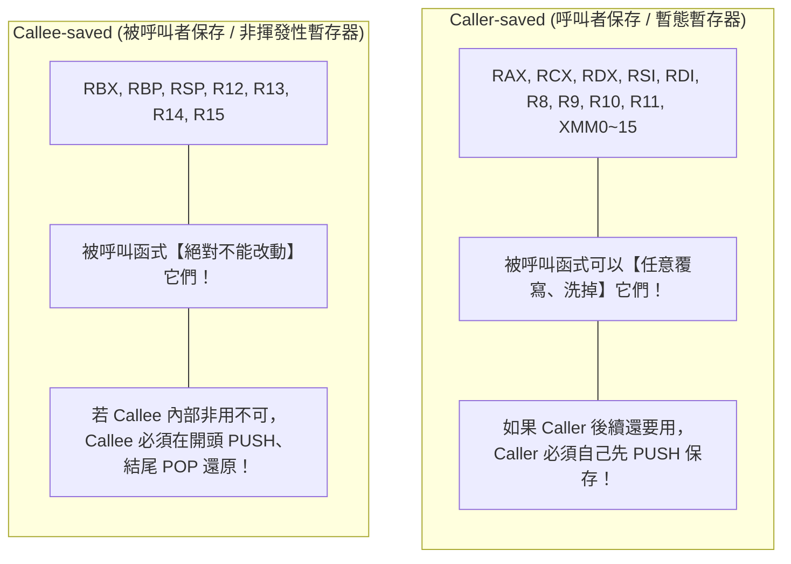

# x86-64 函式呼叫與參數傳遞指南（Calling Conventions & ABI）

> 本文系統性解析 x86-64 架構下的**函式呼叫慣例（Calling Conventions）**與**應用二進位介面（ABI）**，深入剖析暫存器傳參順序、堆疊責任劃分（Caller/Callee-saved）、堆疊對齊陷阱、Red Zone 特性，以及 Linux 函式呼叫與 `syscall` 之間的微妙差異。

---

## 目錄
1. [什麼是呼叫慣例（Calling Convention）與 ABI？](#一什麼是呼叫慣例calling-convention與-abi)
2. [32 位元 vs 64 位元的典範轉移](#二32-位元-vs-64-位元的典範轉移)
3. [System V AMD64 ABI（Linux / macOS）傳參核心規則](#三system-v-amd64-abilinux--macos傳參核心規則)
4. [Caller-saved vs. Callee-saved：誰該保護誰？](#四caller-saved-vs-callee-saved誰該保護誰)
5. [堆疊對齊（Stack Alignment）與 Red Zone](#五堆疊對齊stack-alignment與-red-zone)
6. [普通函式呼叫 vs. 系統呼叫（syscall）的關鍵差異](#六普通函式呼叫-vs-系統呼叫syscall的關鍵差異)
7. [Linux (System V) vs. Windows (Microsoft x64) 對比](#七linux-system-v-vs-windows-microsoft-x64-對比)
8. [本專案實戰解析（hello-cpu）](#八本專案實戰解析hello-cpu)
9. [傳參速查表（Cheat Sheet）](#九傳參速查表cheat-sheet)

---

## 一、什麼是呼叫慣例（Calling Convention）與 ABI？

當我們在 C 語言中寫下 `int result = add(10, 20);` 時，編譯器底層必須將這個高階語法轉為組合語言。這會衍生出一連串約定問題：
1. `10` 和 `20` 該放在哪個暫存器？還是推入記憶體堆疊（Stack）？
2. 算出來的 `result` 該透過哪個暫存器交回給呼叫者？
3. 被呼叫的函式如果擅自改動了某些暫存器的值，呼叫者會不會被坑？

**呼叫慣例（Calling Convention）** 就是軟硬體之間的一紙「契約」；而定義了完整型別大小、暫存器用途、堆疊佈局與系統介面的總體規範，則稱為 **ABI（Application Binary Interface，應用程式二進位介面）**。

> [!NOTE]
> 唯有全體編譯器（GCC、Clang、Rustc）與手寫組合語言都嚴格遵守同一套 ABI，由不同語言編譯出的 `.o` 目的檔與函式庫才能正確無縫地相互 `call`。

---

## 二、32 位元 vs 64 位元的典範轉移

在組合語言的歷史演進中，參數傳遞的方式經歷了一次巨大的效能革命：

### 1. 32 位元 x86 時代（IA-32）：幾乎全靠堆疊（Stack-based）
在 32 位元時代，CPU 只有可憐的 8 個通用暫存器（EAX, EBX, ECX, EDX, ESI, EDI, EBP, ESP），沒有足夠空間傳參。
* **做法**：幾乎所有參數都透過堆疊傳遞（如經典的 `cdecl` 慣例）。
  ```assembly
  # 32-bit: add(10, 20)
  push 20          # 第 2 個參數先壓棧 (由右至左)
  push 10          # 第 1 個參數再壓棧
  call add
  add esp, 8       # 呼叫者清理堆疊
  ```
* **缺點**：每次呼叫函式都引發頻繁的記憶體讀寫（RAM / Cache），效能低下。

### 2. 64 位元 x86-64 時代（AMD64）：全面轉向暫存器（Register-based）
AMD 在設計 x86-64 時，直接將通用暫存器數量**翻倍至 16 個**（增加了 `R8` ~ `R15`），並將暫存器擴展至 64 位元。
* **革命**：所有主流 64 位元作業系統強制將前幾個參數**全部塞進高速暫存器**，速度比舊時代快上數倍！

---

## 三、System V AMD64 ABI（Linux / macOS）傳參核心規則

在 Linux、macOS、FreeBSD、Android 上，所有程式皆遵循 **System V AMD64 ABI** 規範：

### 1. 整數與指標參數（前 6 個）
前 6 個整數或記憶體指標類型的參數，**由左至右**依序放入下列 6 個暫存器：

| 參數順序 | 64 位元暫存器 | 32 位元暫存器（`int`） | 16 位元暫存器（`short`） | 8 位元暫存器（`char`） |
| :---: | :---: | :---: | :---: | :---: |
| **第 1 個** | **`RDI`** | `EDI` | `DI` | `DIL` |
| **第 2 個** | **`RSI`** | `ESI` | `SI` | `SIL` |
| **第 3 個** | **`RDX`** | `EDX` | `DX` | `DL` |
| **第 4 個** | **`RCX`** | `ECX` | `CX` | `CL` |
| **第 5 個** | **`R8`**  | `R8D` | `R8W`| `R8B` |
| **第 6 個** | **`R9`**  | `R9D` | `R9W`| `R9B` |

> [!TIP]
> **記憶口訣**：**「Di - Si - De - Ca - 8 - 9」**（D-S-D-C-8-9）。

### 2. 浮點數與 SIMD 向量參數（前 8 個）
若參數是 `float`、`double` 或向量型別（如 `__m128`），**獨立使用 XMM 暫存器**：
* 依序放入 **`XMM0`、`XMM1`、`XMM2`、`XMM3`、`XMM4`、`XMM5`、`XMM6`、`XMM7`**。

### 3. 第 7 個及以後的參數（超過暫存器容量時）
若一個函式有超過 6 個整數參數（或超過 8 個浮點參數），多出來的參數會**從右至左（Right-to-Left）壓入記憶體堆疊（Stack）**。

### 4. 函式回傳值（Return Values）
* **整數 / 指標（$\le 64$ 位元）**：放在 **`RAX`**（32 位元放 `EAX`）。
* **128 位元整數（如 `__int128`）**：低 64 位元放在 **`RAX`**，高 64 位元放在 **`RDX`**。
* **浮點數 / 向量**：放在 **`XMM0`**（若為複數則高位放 `XMM1`）。

---

## 四、Caller-saved vs. Callee-saved：誰該保護誰？

在編寫組合語言時，最容易引發崩潰的陷阱就是：**「呼叫完一個函式後，我原本放在暫存器裡的重要資料竟然被覆蓋掉了！」**

ABI 將暫存器劃分成兩大責任陣營：



### 責任對照表

| 分類 | 英文術語 | 涵蓋暫存器 | 職責定義 |
| :--- | :--- | :--- | :--- |
| **Caller-saved** | Volatile / Scratch | `RAX`, `RCX`, `RDX`, `RSI`, `RDI`, `R8`, `R9`, `R10`, `R11`, `XMM0`~`XMM15` | **「免死金牌」屬於 Callee**。<br>函式內部可以隨意塗鴉；呼叫者若還想保留這些暫存器的值，呼叫前必須自己推入堆疊備份。 |
| **Callee-saved** | Non-volatile / Preserved | **`RBX`**, **`RSP`**, **`RBP`**, **`R12`**, **`R13`**, **`R14`**, **`R15`** | **「保護承諾」屬於 Callee**。<br>被呼叫函式執行完畢返回時，必須保證這些暫存器的內容完好如初。 |

> [!IMPORTANT]
> 這也是為什麼在許多程式碼中，運算結果會習慣暫存在 `EBX`（如先前討論的 `lzcnt ebx, eax`）：因為 `RBX` 是 **Callee-saved**，即使中途 `call` 了其他子函式，`EBX` 的數值也絕對不會被破壞！

---

## 五、堆疊對齊（Stack Alignment）與 Red Zone

### 1. 致命的 16-Byte 堆疊對齊陷阱
System V AMD64 ABI 明確要求：
> **在執行 `call` 指令跳入目標函式的瞬間，堆疊指標 `RSP` 的值必須是 16 的倍數（16-byte aligned）！**

* 當你執行 `call` 時，CPU 硬體會自動將 8 位元的返回位址（Return Address）壓入堆疊，此時 `RSP` 會減 8（變成 `16n + 8`）。
* 因此，在進入函式內部（序幕 Prologue）後，若需要配置局部變數，**配置的大小必須補齊使 `RSP` 重新回到 16 的倍數**！
* **後果**：若未對齊 16 位元組，函式內部一旦執行 SSE 向量指令（如 `movdqa`、`movaps`），CPU 會當場拋出 **一般保護錯誤（General Protection Fault, #GP）** 導致程式直接崩潰。

### 2. 紅區（Red Zone）：128 位元組的天然緩衝區
在 AMD64 架構中，`RSP` 以下的 **128 位元組** 空間被稱為 **Red Zone**（即 `[RSP - 1]` 到 `[RSP - 128]`）：
* **特性**：作業系統的中斷處理常式（Interrupt Handler）與訊號（Signal）保證**絕對不會覆蓋這 128 位元組**。
* **黑科技**：葉節點函式（Leaf Functions，即內部不再呼叫任何其他函式的函式）可以直接拿 Red Zone 當局部變數使用，**完全不需要修改 `RSP`（省下 `sub rsp, X` 與 `add rsp, X` 的指令開銷）**！

---

## 六、普通函式呼叫 vs. 系統呼叫（syscall）的關鍵差異

許多工程師在寫組合語言時常犯的隱蔽 BUG：**誤把函式呼叫的傳參順序套用在 `syscall` 上**。

請務必注意**第 4 個參數**的重大差異：

| 參數位置 | 普通函式呼叫（Function Call / `call`） | Linux 系統呼叫（System Call / `syscall`） |
| :---: | :---: | :---: |
| **System Call 號碼** | 無 | **`RAX`**（如 sys_write = 1, sys_exit = 60） |
| **第 1 個參數** | `RDI` | `RDI` |
| **第 2 個參數** | `RSI` | `RSI` |
| **第 3 個參數** | `RDX` | `RDX` |
| **第 4 個參數 ⚠️** | **`RCX`** | **`R10`**（絕對不是 `RCX`！） |
| **第 5 個參數** | `R8` | `R8` |
| **第 6 個參數** | `R9` | `R9` |

### 為什麼系統呼叫的第 4 個參數必須從 `RCX` 改成 `R10`？
因為 x86-64 的 CPU 硬體指令 **`syscall`** 在切換到 Ring 0 核心模式時，硬體電路會**自動無條件將使用者態的當前 `RIP` 存入 `RCX`**、將 `RFLAGS` 存入 `R11`！
如果第 4 個參數用 `RCX`，一執行 `syscall` 該參數就會被硬體當場抹除。因此 Linux 核心規範：**系統呼叫第 4 個參數一律強制改用 `R10`**。

---

## 七、Linux (System V) vs. Windows (Microsoft x64) 對比

如果你跨平台開發，必須特別注意微軟 Windows 採用完全不同的呼叫慣例：

| 比較項目 | System V AMD64 (Linux / macOS) | Microsoft x64 (Windows) |
| :--- | :--- | :--- |
| **整數暫存器容量** | **6 個** (`RDI, RSI, RDX, RCX, R8, R9`) | **僅 4 個** (`RCX, RDX, R8, R9`) |
| **浮點暫存器容量** | **8 個** (`XMM0` ~ `XMM7`) | **4 個** (`XMM0` ~ `XMM3`，與整數槽位共享序號) |
| **影子空間（Shadow Space）** | **無**（不需要） | **強制要求 32 位元組**（呼叫前必須在 Stack 預留） |
| **Red Zone** | **支援 128 位元組** | **完全不支援** |

---

## 八、本專案實戰解析（hello-cpu）

讓我們回到專案程式碼，看看這套規範如何精準落地：

### 1. [`include/print.inc`](../include/print.inc) 中的參數接收與 Callee-saved 保護
在 `print_hex` 函式中：

```assembly
# 輸入參數:
#   rdi = 欲輸出的數值 (最高 64-bit，第 1 個參數)

print_hex:
    sub rsp, 64            # 配置堆疊緩衝區 (同時維持 16-byte 對齊)
    mov [rsp + 48], rbx    # 備份 Callee-saved 暫存器 rbx
    mov [rsp + 56], r12    # 備份 Callee-saved 暫存器 r12

    mov r12, rdi           # 將傳入的第 1 個參數安全存入 r12 (保護不被沖掉)
    ...
    # 函式結尾:
    mov rbx, [rsp + 48]    # 還原 rbx
    mov r12, [rsp + 56]    # 還原 r12
    add rsp, 64
    ret
```

### 2. 呼叫單一參數封裝函式（如 [`src/bmi1.s`](../src/bmi1.s)）
```assembly
lzcnt edi, [number]    # 將結果直接算入第 1 參數暫存器 edi
call print_hex         # print_hex 自動從 edi 取出傳入值
```

---

## 九、傳參速查表（Cheat Sheet）

```text
┌────────────────────────────────────────────────────────┐
│        System V AMD64 ABI (Linux / macOS 64-bit)       │
├──────────────┬─────────────────────────────────────────┤
│ 第 1 參數    │ RDI (EDI, DI, DIL)                      │
│ 第 2 參數    │ RSI (ESI, SI, SIL)                      │
│ 第 3 參數    │ RDX (EDX, DX, DL)                       │
│ 第 4 參數    │ RCX (ECX, CX, CL)  [Syscall 則用 R10]   │
│ 第 5 參數    │ R8  (R8D, R8W, R8B)                     │
│ 第 6 參數    │ R9  (R9D, R9W, R9B)                     │
│ 第 7+ 參數   │ 堆疊 (Stack, 從右至左壓入)              │
│ 浮點參數     │ XMM0 ~ XMM7                             │
│ 回傳值       │ RAX (整數), RDX (高64位), XMM0 (浮點)   │
├──────────────┼─────────────────────────────────────────┤
│ Callee-saved │ RBX, RSP, RBP, R12, R13, R14, R15       │
│ Caller-saved │ RAX, RCX, RDX, RSI, RDI, R8~R11, XMM*   │
│ 堆疊對齊要求 │ call 瞬間必須維持 16 位元組邊界對齊     │
└──────────────┴─────────────────────────────────────────┘
```
