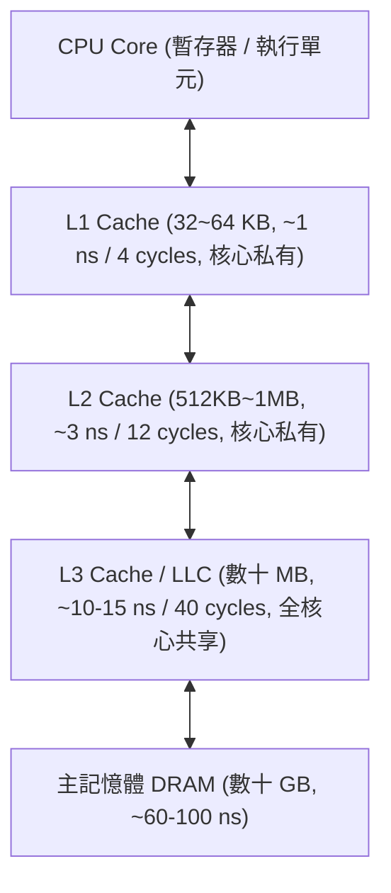

# CPU 快取控制與記憶體屏障指令完整解析指南

> 本文系統性整理 x86-64 架構下所有與**快取控制（Cache Control）**、**非暫態存取（Non-Temporal Streaming）**、**快取預取（Prefetching）** 以及 **記憶體屏障（Memory Fences）** 相關的硬體指令，涵蓋其運作原理、微架構行為、資安攻防意涵與工程實務。

---

## 目錄
1. [現代 CPU 快取架構基礎概念](#一現代-cpu-快取架構基礎概念)
2. [快取行清除、寫回與降級指令](#二快取行清除寫回與降級指令)
3. [記憶體屏障指令（Fences）](#三記憶體屏障指令fences)
4. [非暫態存取指令（Non-Temporal / 繞過快取）](#四非暫態存取指令non-temporal--繞過快取)
5. [軟體快取預取指令（Software Prefetching）](#五軟體快取預取指令software-prefetching)
6. [特權級快取指令（Ring 0 系統管理）](#六特權級快取指令ring-0-系統管理)
7. [快取指令在資安攻防上的角色（側信道攻擊）](#七快取指令在資安攻防上的角色側信道攻擊)
8. [核心指令完整速查對照表](#八核心指令完整速查對照表)
9. [與本專案的關聯與實作](#九與本專案的關聯與實作)

---

## 一、現代 CPU 快取架構基礎概念

現代 CPU 為了弭平暫存器運算速度（< 1 ns）與動態隨機存取記憶體 DRAM（50 ~ 100 ns）之間的巨大延遲差距，建立了多層快取階層（Cache Hierarchy）：



### 關鍵術語
* **快取行（Cache Line）**：CPU 快取與記憶體資料交換的**最小基本單位**。在幾乎所有現代 x86-64 處理器上，快取行大小固定為 **64 位元組（64 Bytes）**。
* **Dirty（髒資料）**：快取中的資料已被 CPU 寫入修改，但尚未同步寫回主記憶體。
* **Clean（乾淨資料）**：快取中的資料與主記憶體內容一致。
* **MESI / MOESI 協定**：多核心處理器透過匯流排監聽（Bus Snooping）維持各核心快取資料一致性的硬體狀態機。

---

## 二、快取行清除、寫回與降級指令

這組指令允許使用者模式（Ring 3）程式直接精準控制**單一快取行**的生命週期。

### 1. `clflush`（Cache Line Flush）
* **引入架構**：Pentium 4（SSE2）
* **語法**：`clflush [m8]`
* **行為**：
  1. 檢查包含該記憶體位址的 64-byte 快取行是否存在於 L1/L2/L3 中。
  2. 若為 Dirty，先將其**寫回主記憶體**。
  3. 將該快取行從**所有 CPU 核心的全部快取層級中無效化（Invalidate / 逐出）**。
* **特點與缺點**：
  * **強烈序列化（Strongly Ordered / Serialized）**：執行時會阻礙前後指令的管線流動，無法平行化，批量清除大記憶體時效能低落。

### 2. `clflushopt`（Cache Line Flush Optimized）
* **引入架構**：Skylake（2015）
* **語法**：`clflushopt [m8]`
* **核心最佳化**：
  * **弱序與可平行化（Weakly Ordered & Pipelined）**：只要目標是「不同快取行」，多條 `clflushopt` 可以**亂序且並行進入管線執行**。
  * 吞吐量相較於 `clflush` 提升 **3 ~ 10 倍**。
  * 必須搭配 `sfence` 來確保所有清除操作真正完成。

### 3. `clwb`（Cache Line Write Back）
* **引入架構**：Skylake Server / Ice Lake
* **語法**：`clwb [m8]`
* **行為**：
  * 若快取行為 Dirty，將其**寫回主記憶體**，但**不從快取中逐出**（保留該行，將狀態標記為 Clean）。
* **核心價值**：
  * 專為**持久記憶體（Persistent Memory / NVDIMM）**設計：既保證資料已經落盤安全，又讓 CPU 下次讀取時仍能享受快取命中（Cache Hit），避免後續讀取產生 DRAM 延遲。

### 4. `cldemote`（Cache Line Demote）
* **引入架構**：Tremont / Alder Lake（第 12 代 Core）
* **語法**：`cldemote [m8]`
* **行為**：
  * 向硬體發出提示（Hint）：將指定的快取行從**私有快取（L1/L2）主動降級推移至共享快取（L3 / LLC）**。
* **核心價值**：
  * **跨核心共享資料加速**：當核心 A 準備把一筆資料交給核心 B 處理時，核心 A 主動 `cldemote` 將資料退至 L3。核心 B 讀取時就不用向核心 A 的私有 L1 發起緩慢的快取一致性探針（Cache Snoop）。

---

## 三、記憶體屏障指令（Fences）

x86 架構採用 **TSO（Total Store Order）** 強記憶體模型，硬體**只允許一種重排：Store-Load 重排（寫入緩衝區延遲）**。為了控制快取刷新、非暫態寫入以及亂序管線，x86 提供了三條屏障指令：

### 1. `sfence`（Store Fence，寫入屏障）
* **作用範圍**：僅管 **寫入（Store）** 與 **快取刷新（Flush）**。
* **保證**：所有在 `sfence` 之前的寫入、`clflushopt`、`clwb` 以及非暫態寫入，在 `sfence` 之後的任何寫入執行前，**必須對全域可見**。
* **開銷**：輕量，不會卡住讀取管線。
* **實戰必用場景**：非暫態串流寫入（`MOVNT` 刷空 WC 緩衝區）、持久記憶體交易提交（`CLWB` + `SFENCE`）、PCIe/網卡 MMIO 門鈴防脫節（詳見 [`docs/memory_order.md`](memory_order.md)）。

### 2. `lfence`（Load Fence，讀取屏障）
* **作用範圍**：僅管 **讀取（Load）**。
* **保證**：所有在 `lfence` 之前的讀取操作必須完成，後續的讀取絕不能被提前執行。
* **微架構副作用（極重要）**：
  * 在現代 Intel/AMD 處理器上，`lfence` 具備**指令分派序列化（Dispatch Serializing）**特性，它會阻斷 CPU 的分支預測與推測執行（Speculative Execution）。因此被廣泛作為 **Spectre 漏洞** 的硬體防禦手段。

### 3. `mfence`（Memory Fence，全域記憶體屏障）
* **作用範圍**：**讀取 + 寫入（雙向全能）**。
* **保證**：排空寫入緩衝區（Store Buffer），確保所有先前的讀寫全部完成，且後續的讀寫均不得跨越。
* **開銷**：最高。多用於無鎖並行演算法（Lock-free Programming）以防止 Store-Load 重排。

---

## 四、非暫態存取指令（Non-Temporal / 繞過快取）

一般讀寫都會自動把資料塞進 L1/L2/L3。但當程式需要寫入數 GB 的大資料（如大檔拷貝、音訊視訊編碼）時，這些資料只會被寫入一次，塞滿快取只會把真正高頻使用的熱資料擠出快取，稱為**快取污染（Cache Pollution）**。

「非暫態（Non-Temporal）」代表向 CPU 暗示：**「這筆資料我短時間內不會再用，請直接寫入主記憶體，不要留在快取裡！」**

```mermaid
flowchart LR
    subgraph 一般寫入
        A1[CPU] -->|寫入| B1[L1/L2/L3 快取 (排擠熱資料)]
        B1 -->|最終寫回| C1[RAM]
    end
    
    subgraph 非暫態寫入 (Streaming Store)
        A2[CPU] -->|繞過快取| B2[Write-Combining Buffer (WC)]
        B2 -->|批次直通寫入| C2[RAM]
    end
```

### 核心指令列表

| 指令 | 暫存器類型 | 資料大小 | 說明 |
| :--- | :--- | :--- | :--- |
| **`movnti`** | 通用暫存器（GPR） | 32 / 64 bits | 將 32 或 64 位元整數繞過快取直接寫入記憶體 |
| **`movntq`** | MMX 暫存器 | 64 bits | 64 位元向量非暫態寫入（舊） |
| **`movntdq`** | XMM 暫存器 | 128 bits | 128 位元整數向量非暫態寫入（極常用於 `memcpy`） |
| **`movntps`** | XMM 暫存器 | 128 bits | 128 位元單精度浮點向量非暫態寫入 |
| **`movntpd`** | XMM 暫存器 | 128 bits | 128 位元雙精度浮點向量非暫態寫入 |
| **`vmovntdq`**| YMM / ZMM 暫存器 | 256 / 512 bits | AVX2 / AVX-512 高寬度串流寫入 |
| **`movntdqa`**| XMM 暫存器 | 128 bits | **串流非暫態讀取**（從 WC 記憶體快速載入） |

> [!IMPORTANT]
> 非暫態寫入會暫存於 CPU 的 **Write-Combining（WC）緩衝區**，這類寫入是不保證順序的！**完成非暫態寫入後，務必呼叫 `sfence` 排空 WC 緩衝區**，資料才會真正寫入 RAM。

---

## 五、軟體快取預取指令（Software Prefetching）

CPU 本身有硬體預取器（Hardware Prefetcher），能自動識別線性步進的記憶體存取。但對於複雜的資料結構（如二元樹、圖形、雜湊表跳轉），硬體無法預測，此時可透過軟體指令主動告訴 CPU：**「把這個記憶體位址提前搬進快取！」**

預取指令**完全是非阻塞（Non-blocking）的提示性指令**：即使位址無效或引發 Page Fault，CPU 會直接忽略該指令，絕不拋出異常。

### 1. 預取目標層級指令

* **`prefetcht0`（Temporal to L1/L2/L3）**：
  預取資料至**所有層級的快取**（L1、L2、L3），適合即將高頻密集讀取的熱資料。
* **`prefetcht1`（Temporal to L2/L3）**：
  預取至 L2 與 L3，**跳過 L1**。
* **`prefetcht2`（Temporal to L3）**：
  預取至 L3，**跳過 L1 與 L2**。
* **`prefetchnta`（Non-Temporal Prefetch）**：
  非暫態預取。將資料載入最接近核心的快取（L1），但使用後儘快逐出，盡量減少對其他資料的快取污染。

### 2. 針對寫入的專屬預取

* **`prefetchw`（Prefetch with Intent to Write）**：
  * 引入：AMD 早在 3DNow! 引入，Intel 自 Broadwell 起全面納入標準支援。
  * 意義：預先告訴快取控制器「我即將寫入這個位址」。快取控制器會提前將快取行置於 **Modified (M)** 或 **Exclusive (E)** 狀態，避免後續真正寫入時額外引發一次昂貴的 RFO（Read For Ownership）匯流排交易。

---

## 六、特權級快取指令（Ring 0 系統管理）

以下指令僅限於**作業系統核心（Kernel）或虛擬機監控器（Hypervisor）**執行，一般應用程式無權使用：

| 指令 | 中文名稱 | 行為與影響 | 風險等級 |
| :--- | :--- | :--- | :--- |
| **`wbinvd`** | 寫回並無效化全部快取 | 將 CPU **所有核心、所有層級的整個快取**完全寫回主記憶體並清空。開銷極大，會暫停整個 CPU 匯流排數十微秒。 | ⚠️ 高開銷（系統進入休眠/關機時使用） |
| **`invd`** | 無效化全部快取（不寫回） | **不寫回 Dirty 資料，直接強制丟棄所有快取！** 若記憶體未同步，會導致嚴重的資料遺失或核心崩潰。 | 🚨 極度危險（通常僅在硬體重置或測試時使用） |
| **`invlpg`** | 無效化 TLB 分頁 | 清除 MMU 的虛擬位址轉換快取（TLB），在修改頁表（Page Table）時必須呼叫。 | ⚠️ 核心記憶體管理必備 |

---

## 七、快取指令在資安攻防上的角色（側信道攻擊）

快取指令本意是用於效能最佳化，但它們在近代微架構安全研究中成為了旁路攻擊（Side-Channel Attacks）的致命核心工具：

### 1. Flush+Reload 攻擊模型
1. **Flush**：攻擊者呼叫 `clflushopt [target_addr]`，將受害者程式即將執行的函數（如 AES S-Box 表）從快取中清空。
2. **Wait**：讓受害者程式執行一段時間。
3. **Reload**：攻擊者使用 `rdtscp` 測量自己重新讀取 `target_addr` 所需的 CPU 週期數：
   * **耗時 < 50 cycles**：Cache Hit！受害者剛才存取過該記憶體，逆推受害者輸入。
   * **耗時 > 200 cycles**：Cache Miss！受害者剛才未存取該位址。

### 2. 投機執行防禦（Spectre Mitigation）
在 Spectre 漏洞中，CPU 會在條件分支尚未確定前進行猜測執行，並把秘密資料讀入快取。
* **防禦解法**：在條件判斷分支後強制插入 **`lfence`** 指令，硬性中斷推測執行，確保暫存器真正驗證合法後才准載入記憶體。

---

## 八、核心指令完整速查對照表

| 分類 | 指令 | 權限 | 引入架構 | 主要用途 | 建議搭配 |
| :--- | :--- | :--- | :--- | :--- | :--- |
| **快取清除** | `clflush` | Ring 3 | Pentium 4 (SSE2) | 寫回並逐出快取行（嚴格序列化，較慢） | 無需搭配 |
| | `clflushopt` | Ring 3 | Skylake (2015) | 寫回並逐出快取行（平行管線化，極快） | `sfence` |
| | `clwb` | Ring 3 | Skylake Server | 寫回 Dirty 快取行但不逐出（保持快取命中） | `sfence` |
| | `cldemote` | Ring 3 | Alder Lake (2021) | 將快取行由 L1/L2 退回 L3（加速跨核共享） | 無 |
| **記憶體屏障** | `sfence` | Ring 3 | Pentium III (SSE) | 寫入與快取刷新屏障（排空 WC 緩衝區） | `movnt*` / `clflushopt` |
| | `lfence` | Ring 3 | Pentium 4 (SSE2) | 讀取屏障、管線序列化、防範 Spectre 推測 | 關鍵分支判斷 |
| | `mfence` | Ring 3 | Pentium 4 (SSE2) | 全域讀寫雙向屏障，排空 Store Buffer | 無鎖並發演算法 |
| **非暫態存取** | `movnti` | Ring 3 | Pentium 4 (SSE2) | 通用暫存器 32/64-bit 繞過快取寫入 RAM | `sfence` |
| | `movntdq` | Ring 3 | Pentium 4 (SSE2) | XMM 128-bit 繞過快取串流寫入 | `sfence` |
| | `vmovntdq`| Ring 3 | AVX2 / AVX-512 | YMM/ZMM 256/512-bit 繞過快取串流寫入 | `sfence` |
| | `movntdqa`| Ring 3 | Penryn (SSE4.1) | 從 WC 記憶體快速串流載入 | 無 |
| **快取預取** | `prefetcht0`| Ring 3 | Pentium III (SSE) | 預取資料至 L1/L2/L3 全快取層級 | 無 |
| | `prefetchnta`| Ring 3 | Pentium III (SSE) | 非暫態預取，避免污染熱快取 | 無 |
| | `prefetchw` | Ring 3 | Broadwell (Intel) | 帶寫入意圖預取，提前取得獨佔 (E/M) 權 | 寫入熱迴圈 |
| **特權維護** | `wbinvd` | Ring 0 | 486 | 寫回並清空所有 CPU 的全部快取階層 | 僅限 OS 核心 |
| | `invd` | Ring 0 | 486 | 強制清空全部快取（不寫回，極危險） | 僅限 OS 核心 |

---

## 九、與本專案的關聯與實作

在本 `hello-cpu` 專案中，你可以透過以下檔案觀察與實踐快取控制：

* [`src/clflushopt.s`](../src/clflushopt.s)：示範完整的 `clflushopt` 快取行最佳化清除與 `mfence` 屏障同步呼叫。
* [`src/rdtscp.s`](../src/rdtscp.s)：序列化讀取 CPU 週期計數器，此技術搭配 `clflushopt` 即可構成高精度的快取命中/未命中延遲基準測試。
