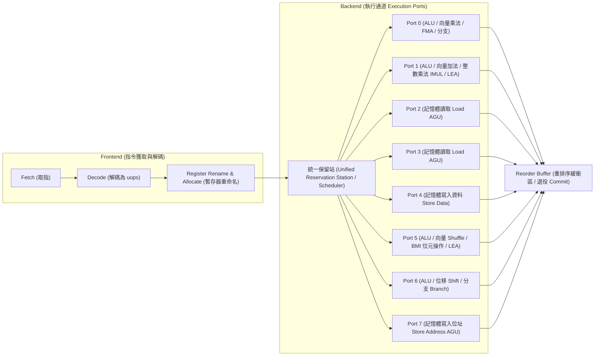
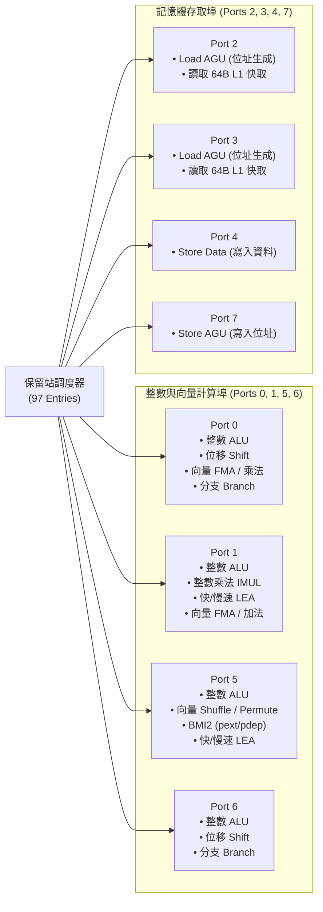

# CPU 執行通道（Execution Ports）與微架構資源競爭全解指南

> 在現代超純量（Superscalar）、亂序執行（Out-of-Order, OoO）微架構中，CPU 宣稱每個時脈週期可以執行 4 條、6 條甚至 8 條指令（IPC > 1）。
> 然而，**「為什麼程式碼明明沒有相依性，IPC 卻遠低於預期？」** 
> 答案往往藏在 CPU 後端最深處的物理瓶頸——**執行通道衝突（Execution Port Contention）與調度飽和**。

---

## 目錄
1. [什麼是執行通道（Execution Ports）？](#一什麼是執行通道execution-ports)
2. [現代 CPU 的 Port 拓撲結構解析](#二現代-cpu-的-port-拓撲結構解析)
   * [2.1 Intel Skylake 8-Port 微架構（本機基準）](#21-intel-skylake-8-port-微架構本機基準)
   * [2.2 Intel Golden Cove 12-Port 現代旗艦架構](#22-intel-golden-cove-12-port-現代旗艦架構)
   * [2.3 Intel 統一調度站 vs. AMD 分離式排程器](#23-intel-統一調度站-vs-amd-分離式排程器)
3. [Port 飽和與衝突（Port Contention）的物理機制](#三port-飽和與衝突port-contention的物理機制)
   * [3.1 乘法器塞車（Port 1 瓶頸）](#31-乘法器塞車port-1-瓶頸)
   * [3.2 向量 Shuffle / Permute 塞車（Port 5 瓶頸）](#32-向量-shuffle--permute-塞車port-5-瓶頸)
   * [3.3 記憶體讀取與寫入通道衝突](#33-記憶體讀取與寫入通道衝突)
4. [延遲（Latency）vs. 吞吐量（Throughput）的微架構本質](#四延遲latency-vs-吞吐量throughput的微架構本質)
5. [軟體工程與編譯器如何進行「Port 平衡（Port Balancing）」？](#五軟體工程與編譯器如何進行port-平衡port-balancing)
   * [5.1 算術替代：LEA 跨通道負載均衡](#51-算術替代lea-跨通道負載均衡)
   * [5.2 循環展開（Loop Unrolling）與多管齊下](#52-循環展開loop-unrolling與多管齊下)
   * [5.3 避免除法器（Divider）非管線化霸佔](#53-避免除法器divider非管線化霸佔)
6. [使用 Linux perf 與 PMU 抓出 Port 衝突](#六使用-linux-perf-與-pmu-抓出-port-衝突)
7. [與本專案微基準測試的對照](#七與本專案微基準測試的對照)

---

## 一、什麼是執行通道（Execution Ports）？

現代 CPU 不只是一個單一的「運算大腦」，而是一座內部擁有數十個專屬工段的超級現代化流水線工廠：



### 關鍵概念
1. **微操作（$\mu\text{op}$ / Micro-operation）**：
   x86 複雜指令（CISC）在前端會被解碼器拆解為一到多個類似 RISC 的微操作（$\mu\text{op}$）。
2. **保留站（Reservation Station, RS）**：
   待執行的 $\mu\text{ops}$ 暫存在保留站中等待運算元就緒。只要運算元齊備，調度器每週期會挑選數個 $\mu\text{ops}$ 發射（Dispatch）至對應的**執行通道（Execution Port）**。
3. **執行通道（Port）**：
   通道是調度器與底層實體硬體算子（ALU、浮點乘法器、AGU、Shuffle 單元）之間的**多工分派插槽（Dispatch Port）**。

---

## 二、現代 CPU 的 Port 拓撲結構解析

### 2.1 Intel Skylake 8-Port 微架構（本機基準）

本專案運行之測試機處理器（Intel Core i5-8250U, Kaby Lake-R）採用經典的 **Skylake 8 通道微架構**，其硬體單元分配如下：



* **整數算術吞吐量上限**：
  Port 0、1、5、6 都擁有完整的整數基礎 ALU，因此理論上 Skylake 在單一週期內最多能同時執行 **4 條獨立的整數加法（IPC = 4）**！
* **記憶體吞吐量上限**：
  Port 2 和 Port 3 同時為 Load AGU，因此每週期最多支援 **2 次 256-bit 讀取（64 Bytes/cycle 載入頻寬）**。

---

### 2.2 Intel Golden Cove 12-Port 現代旗艦架構

在第 12/13/14 代 Core（Alder Lake / Raptor Lake）的 P-Core（Golden Cove 架構）中，Intel 將通道數量大幅擴充到 **12 個 Ports（Port 0 ~ 11）**：

* **6 個整數 ALU**：Port 0, 1, 5, 6, 10, 11，整數運算吞吐量躍升至每週期 6 條。
* **3 個 Load AGU**：Port 2, 3, 7 同時支援載入，每週期讀取頻寬提升 50%。
* **2 個 Store AGU + 2 個 Store Data**：Port 8, 9, 4 徹底獨立，消除寫入排隊瓶頸。

---

### 2.3 Intel 統一調度站 vs. AMD 分離式排程器

在微架構設計哲學上，兩大巨頭展現了截然不同的取捨：

| 架構對比 | Intel（Skylake / Golden Cove） | AMD（Zen 3 / Zen 4 / Zen 5） |
| :--- | :--- | :--- |
| **排程器結構** | **統一保留站（Unified RS / Scheduler）** | **分散式佇列（Distributed Schedulers）** |
| **運作機制** | 所有整數、浮點、記憶體 $\mu\text{ops}$ 擠在同一張大表（如 Skylake 97 項、Golden Cove 512 項），由大調度器統籌發射至各 Port。 | 整數 ALU、向量 FPU、記憶體 Load/Store 各自擁有**獨立的專屬調度佇列**。 |
| **優勢** | 資源共享率極高，某類指令較少時空間能動態讓給其他指令。 | 電路簡單、單一佇列延遲更低、更容易堆疊超寬發射寬度。 |
| **劣勢** | 統一陣列電路複雜，時脈拉高時發熱量極大。 | 若程式全充斥某一類指令（如純浮點），該專屬佇列容易被擠爆，而整數佇列閒置。 |

---

## 三、Port 飽和與衝突（Port Contention）的物理機制

什麼是 **Port Contention（通道衝突）**？
> 當程式碼中連續出現多條「只能由特定單一 Port 執行」的指令時，即使其他 6~7 個 Port 完全空閒，這些指令也必須在保留站中**排成一列、依序輪流發射**，導致 CPU 後端管線利用率暴跌。

### 3.1 乘法器塞車（Port 1 瓶頸）

在 Skylake 微架構中，翻開手冊附錄，你會發現一項驚人的事實：
> **硬體整數乘法器（Integer Multiplier）在全晶片只有「唯一的一顆」，並且只掛在 Port 1 上！**

如果你的程式碼需要進行大量密集整數乘法：
```assembly
# ❌ Port 1 嚴重堵塞案例：
imul rax, rbx          # 只能走 Port 1
imul rcx, rdx          # 只能走 Port 1 (被迫排隊等待)
imul r8,  r9           # 只能走 Port 1 (被迫排隊等待)
imul r10, r11          # 只能走 Port 1 (被迫排隊等待)
```
* **後果**：
  雖然這四組乘法彼此**毫無資料相依性（No RAW Dependency）**，理論上可以平行；但因為它們全都要爭搶 **Port 1**，CPU 每個週期只能放行一條！
  此時 Port 0, 5, 6 的 ALU 只能乾瞪眼，總體 IPC 被物理卡死在 **1.0**。

---

### 3.2 向量 Shuffle / Permute 塞車（Port 5 瓶頸）

在高效能影像處理、JSON 解析與矩陣轉置中，頻繁需要使用 SIMD 洗牌指令（如 `pshufb`, `vperm2i128`, `vpermps`）：
> **全功能 256 位元向量洗牌單元（Vector Shuffle Unit）全晶片只有「唯一的一套」，位於 Port 5！**

```assembly
# ❌ Port 5 堵塞案例：
vpshufb ymm0, ymm0, ymm15   # 只能走 Port 5
vpshufb ymm1, ymm1, ymm15   # 只能走 Port 5 (等待)
vpshufb ymm2, ymm2, ymm15   # 只能走 Port 5 (等待)
vpshufb ymm3, ymm3, ymm15   # 只能走 Port 5 (等待)
```
哪怕 CPU 前端每週期能抓取 4~5 條指令，受限於 Port 5 的單一硬體電路，洗牌指令每週期只能吞吐 1 條。

---

### 3.3 記憶體讀取與寫入通道衝突

* **Load 頻寬**：Port 2 與 Port 3。如果迴圈中每個週期需要載入 3 個數值，其中一個必須排隊到下一個週期。
* **Store 頻寬**：寫入操作必須拆解為：
  1. 生成寫入位址（Store AGU -> 走 Port 7 或 Port 8）
  2. 提交寫入資料（Store Data -> 走 Port 4）
  若兩者發射速率不匹配，寫入緩衝區（Store Buffer）會迅速堆積，反壓阻塞保留站。

---

## 四、延遲（Latency）vs. 吞吐量（Throughput）的微架構本質

在官方手冊《Optimization Reference Manual: Volume 2》中，所有指令的核心規格由兩個關鍵數字定義：

```text
指令延遲 (Latency):              [--- 週期 1 ---][--- 週期 2 ---][--- 週期 3 ---]
                                                     ↑ 結果計算完成，後續指令可讀取

反向吞吐量 (Reciprocal TP = 1.0): [ 指令 A 發射 ]
                                                [ 指令 B 發射 ] (間隔 1 cycle 即可塞下一條)
```

1. **延遲（Latency）**：
   一條指令從**輸入運算元進入 Port** 到**產出結果寫入暫存器**所需的完整時脈週期數。
2. **反向吞吐量（Reciprocal Throughput, R-TP）**：
   在沒有相依性的情況下，同一類型的指令發射之間所需的**最小時脈間隔**。
   * $\text{R-TP} = 0.5$：代表該硬體單元有 2 個副本（如整數加法在 Port 0/1 都有），每週期可發射 2 條。
   * $\text{R-TP} = 1.0$：代表該硬體單元只有 1 個（如 `imul` 只有 Port 1），每週期最多發射 1 條。
   * $\text{R-TP} > 1.0$：代表該硬體單元**非完全管線化（Non-pipelined）**，運算期間會霸佔 Port，後續指令必須等待多個週期才能進去。

---

## 五、軟體工程與編譯器如何進行「Port 平衡（Port Balancing）」？

理解了 Port Usage 的物理分佈，軟體工程師與編譯器後端（LLVM/GCC）才能施展頂級優化技巧：

### 5.1 算術替代：LEA 跨通道負載均衡

在我們專案的 [`src/demo/1978_lea.s`](file:///home/harvey/hello-cpu/src/demo/1978_lea.s) 與 [`src/perf/2013_mul_lat.s`](file:///home/harvey/hello-cpu/src/perf/2013_mul_lat.s) 中，展示了乘常數 3 的兩種做法：

```assembly
# 方案 A: 使用 IMUL
imul rax, 3                 # 延遲 3 cycles，且【只能走 Port 1】

# 方案 B: 使用 LEA
lea rax, [rax + rax*2]      # 延遲 1 cycle，且【可以走 Port 0 或 Port 1 或 Port 5】！
```

* **微架構收益**：
  `lea` 不僅延遲只有 1 個週期，更重要的是它**解除了對 Port 1 的單一綁定**！調度器可以彈性地將 `lea` 丟給當前較空閒的 Port 0 或 Port 5，把寶貴的 Port 1 留給其他非用乘法器不可的指令。

---

### 5.2 循環展開（Loop Unrolling）與多管齊下

考慮以下累加陣列的簡單迴圈：
```c
// 未展開迴圈
for (int i = 0; i < N; i++) {
    sum += arr[i];          // 致命的 RAW 相依鏈：每次加法都必須等上一輪加完
}
```
因為每一輪的 `sum` 都依賴上一輪結果，流水線永遠只有 1 條指令在跑，Port 利用率極其低下。

**利用 4 路展開打破相依鏈，同時喂滿 4 個 ALU Ports**：
```c
// 4 路累加器並行 (Unrolled with 4 Accumulators)
int s0 = 0, s1 = 0, s2 = 0, s3 = 0;
for (int i = 0; i < N; i += 4) {
    s0 += arr[i];       // 發射至 Port 0
    s1 += arr[i+1];     // 發射至 Port 1
    s2 += arr[i+2];     // 發射至 Port 5
    s3 += arr[i+3];     // 發射至 Port 6
}
int sum = (s0 + s1) + (s2 + s3);
```
這 4 個加法彼此**完全獨立**，調度器可以在**同一個時脈週期內**將它們同時分派進 Port 0, 1, 5, 6 執行，讓 IPC 直接翻倍逼近 4.0！

---

### 5.3 避免除法器（Divider）非管線化霸佔

如前所述，除法器（位於 Port 0）是非管線化的。
在迴圈中，**一條 `div` 指令會卡死 Port 0 長達 15~30 個週期**，期間 Port 0 的整數加法、分支預測全都無法使用。
* **工程解法**：
  * 編譯器在已知除數為常數時，必定使用**魔術數字乘法 + 位移（Magic Number Division via Reciprocal Multiplication）**替代除法（以 `imul` + `sar` 解決），將延遲從 30 週期壓低到 4 週期，且保持管線完全流暢！

---

## 六、使用 Linux perf 與 PMU 抓出 Port 衝突

現代 Intel CPU 的硬體效能監控單元（Performance Monitoring Unit, PMU）內建了專門針對各個 Port 分派計數的事件（Hardware Events）。

在 Linux 終端機中，你可以直接使用 `perf stat` 來測量指定程式在各個 Port 上的利用率：

```bash
# 測量 8 個 Port 的派發次數
perf stat -e \
  uops_dispatched_port.port_0,\
  uops_dispatched_port.port_1,\
  uops_dispatched_port.port_2,\
  uops_dispatched_port.port_3,\
  uops_dispatched_port.port_4,\
  uops_dispatched_port.port_5,\
  uops_dispatched_port.port_6,\
  uops_dispatched_port.port_7 \
  ./bin/perf/2013_mul_lat
```

### 輸出範例與診斷要訣：
* **健康平衡的程式碼**：Port 0, 1, 5, 6 的數值分佈相對均勻。
* **遭遇 Port 衝突的程式碼**：
  * 若發現 `port_1` 高達數億次，而 `port_0`, `port_5`, `port_6` 只有幾百萬次，代表程式碼存在嚴重的**整數乘法或特定 LEA 堵塞**！
  * 若 `port_5` 畸高，代表存在嚴重的 **SIMD Shuffle / PEXT / PDEP** 單一通道飽和。

---

## 七、與本專案微基準測試的對照

| 本專案實作檔案 | 涉及核心指令 | 微架構 Port 關鍵關聯 |
| :--- | :--- | :--- |
| [`src/demo/1978_lea.s`](file:///home/harvey/hello-cpu/src/demo/1978_lea.s) | `lea` | 支援 Port 0, 1, 5 自由分派，分擔純量乘法器負載 |
| [`src/perf/2013_mul_lat.s`](file:///home/harvey/hello-cpu/src/perf/2013_mul_lat.s) | `imul`, `mulx` | 驗證綁定單一 Port 1 的依賴鏈延遲與記憶體轉發懲罰 |
| [`src/demo/2013_bmi2.s`](file:///home/harvey/hello-cpu/src/demo/2013_bmi2.s) | `pext`, `pdep` | 高階位元操作綁定 Port 5 的吞吐限制 |
| [`src/perf/2013_simd_add8.s`](file:///home/harvey/hello-cpu/src/perf/2013_simd_add8.s) | `add`, `paddd`, `vpaddd` | 比較純量 8x ADD（搶佔 4 ALU ports）vs 單條 AVX2（1 port 搞定 8 個整數）的架構效率差距 |
| [`src/perf/branch-predict.s`](file:///home/harvey/hello-cpu/src/perf/branch-predict.s) | `cmovge` | 將分支控制流轉為資料流相依，解除 Port 0/6 的分支單元排程壓力 |

---

### 總結
硬體宣稱的「多發射超純量」只是理論上限。真正決定高階系統程式碼極致效能的，是**指令底層所佔用的執行通道是否被均勻餵飽、是否發生通道爭奪**。掌握 Port Usage 的拓撲邏輯，是從「只會寫 C++」邁向「懂得如何調教硬體極限」的必經之路。
